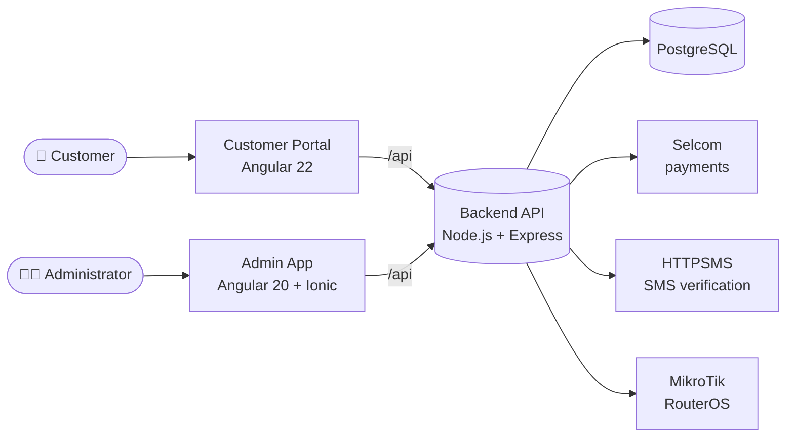

<div align="center">

# 📡 Internet Monitoring System

**A multi-tenant platform for ISPs to sell, manage and monitor Wi-Fi access.**
Packages · Payments · Sessions · MikroTik routers — all in one place.

<br />


[Features](#-features) ·
[Architecture](#-architecture) ·
[Getting started](#-getting-started) ·
[Configuration](#-configuration) ·
[Testing](#-tests--builds) ·
[Docs](#-documentation)

</div>

---

## ✨ Overview

Internet Monitoring System lets an ISP (or many ISPs on one platform) run a paid Wi-Fi hotspot business end to end:

1. A customer connects to the hotspot and opens the **customer portal**.
2. They pick a **package** and pay with mobile money or cash.
3. The **backend** verifies the payment and tells the **MikroTik router** to grant access.
4. Administrators track sessions, revenue and packages from the **admin app**.

**Repository:** [RealMwita/internet-monitoring-system](https://github.com/RealMwita/internet-monitoring-system)

## 🚀 Features

| | |
| --- | --- |
| 🏢 **Multi-tenant** | Each company has its own administrators, packages, payments, branding and network settings |
| 🛒 **Customer checkout** | Browse packages, pay, check payment status, view session and reconnect after expiry |
| 💳 **Payments** | Selcom integration, SMS-based payment verification (HTTPSMS), cash payments, encrypted provider credentials |
| 📶 **MikroTik integration** | Grants and revokes customer internet access on RouterOS devices |
| 🔐 **Secure by default** | JWT auth, bcrypt password hashing, role-based access (company admin / superadmin) |
| 📊 **Dashboards & reports** | Company and platform-wide dashboards, sessions, payments and reports |
| 🎨 **Company branding** | Custom logos and banner images with server-side validation |
| 🌍 **Bilingual** | English and Swahili interfaces in both web apps |

## 🧱 Architecture



| Component | Directory | Stack | Purpose |
| --- | --- | --- | --- |
| **Backend API** | [`backend/`](backend) | Node.js, Express 5, PostgreSQL | Auth, payments, sessions, router control |
| **Customer portal** | [`customer-portal/`](customer-portal) | Angular 22 | Package discovery and purchase |
| **Admin app** | [`admin-app/`](admin-app) | Angular 20, Ionic 8, Capacitor | Company and platform administration |
| **Shared code** | [`shared/`](shared) | TypeScript | Utilities shared across components |
| **Docs** | [`docs/`](docs) | Markdown | Technical handoff and progress notes |

## 📋 Requirements

- **Node.js** and **npm** (versions supported by the Angular releases above)
- **PostgreSQL**
- **MikroTik RouterOS** device(s) reachable from the backend (for network features)
- **Payment provider** credentials, e.g. Selcom (for payment features)

## 🏁 Getting started

### 1. Clone

```bash
git clone https://github.com/RealMwita/internet-monitoring-system.git
cd internet-monitoring-system
```

### 2. Configure and run the backend

```powershell
Copy-Item backend/.env.example backend/.env
```

Edit `backend/.env` with your database details, then generate secrets locally:

```bash
# JWT_SECRET
node -e "console.log(require('node:crypto').randomBytes(32).toString('hex'))"

# PAYMENT_ENCRYPTION_KEY
node -e "console.log(require('node:crypto').randomBytes(32).toString('base64'))"
```

> [!WARNING]
> Keep `PAYMENT_ENCRYPTION_KEY` stable and backed up. Changing it makes previously stored provider credentials impossible to decrypt. Never commit `.env` files.

> [!NOTE]
> The SQL files in `backend/src/database/migrations/` add specific integrations; they are **not** a complete initial schema. Apply the base application schema before starting the API.

```bash
cd backend
npm install
npm run dev        # nodemon, auto-reload
```

The API listens on port **4000** by default (override with `PORT`).

### 3. Run the customer portal

```bash
cd customer-portal
npm install
npm start
```

### 4. Run the admin app

```bash
cd admin-app
npm install
npm start
```

Both dev servers proxy `/api` (and `/uploads` for the portal) to `http://127.0.0.1:4000`. Open the local URL printed by the Angular CLI.

## ⚙️ Configuration

All backend settings live in [`backend/.env.example`](backend/.env.example).

| Variable | Description |
| --- | --- |
| `PORT` | API port (default `4000`) |
| `DB_HOST` `DB_PORT` `DB_NAME` `DB_USER` `DB_PASSWORD` | PostgreSQL connection |
| `JWT_SECRET` | Secret used to sign admin tokens |
| `JWT_EXPIRES_IN` | Token lifetime (default `1d`) |
| `PAYMENT_ENCRYPTION_KEY` | 32 random bytes, base64. Encrypts stored payment credentials |
| `PUBLIC_API_URL` | Public URL of the API, used in payment callbacks |
| `SELCOM_BASE_URL` | Selcom API gateway |
| `MIKROTIK_USERNAME` `MIKROTIK_PASSWORD` | Fallback router credentials (per-router credentials preferred) |

## 🧪 Tests & builds

```bash
# Backend tests (Node's built-in test runner)
cd backend && npm test

# Production builds
cd customer-portal && npm run build
cd admin-app && npm run build
```

## 🗂️ Project structure

```text
.
├── backend/            # Express API
│   ├── services/       # Selcom, MikroTik, payments, session lifecycle
│   ├── src/
│   │   ├── controllers/  # admin · platform · public · integrations · super-admin
│   │   ├── routes/
│   │   ├── middlewares/  # auth, uploads, security
│   │   └── database/     # connection + SQL migrations
│   └── test/
├── customer-portal/    # Angular 22 checkout portal
├── admin-app/          # Angular 20 + Ionic admin dashboard
├── shared/             # Shared TypeScript code
└── docs/               # Handoff and progress notes
```

## 📚 Documentation

- [Technical handoff](docs/TECHNICAL-HANDOFF.md) — architecture and frontend/backend analysis
- [Wi-Fi session progress](docs/WIFI-SESSION-PROGRESS.md) — session lifecycle work
- [Admin setup](admin-app/docs/ADMIN_SETUP.md) · [Admin changes](admin-app/docs/ADMIN_CHANGES.md)
- [Portal setup](customer-portal/docs/PORTAL_SETUP.md) · [Portal changes](customer-portal/docs/PORTAL_CHANGES.md)

## 🛡️ Production checklist

- Serve everything over **HTTPS**
- Use strong, unique secrets and rotate them if exposed
- Restrict database network access and take secure backups
- Store router and payment credentials per environment, never in source control

## 🤝 Contributing

1. Fork the repository and create a feature branch.
2. Make your changes and add or update tests.
3. Open a pull request describing the change and its test results.

## 📄 License

No license has been specified yet. All rights remain with the copyright holder until one is added.
